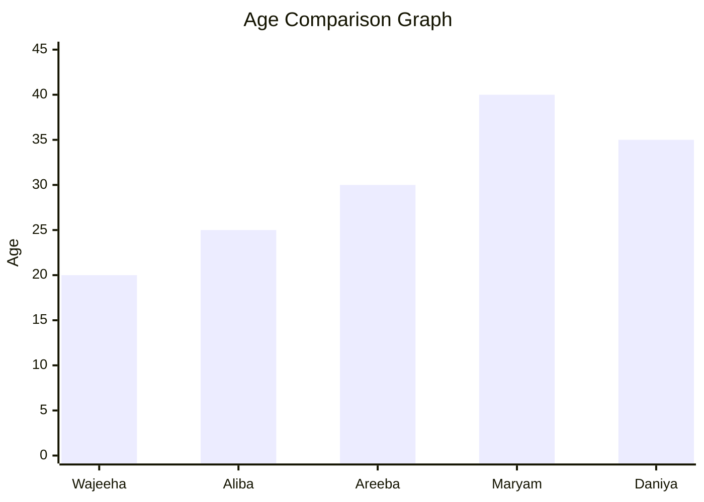

# my-new-project-repository 

# People Age Analysis

| Name | Age | City |
|---|---:|---|
| Afeerah | 20 | Multan |
| Aliba | 25 | Lahore |
| Rabia | 30 | Islamabad |
| Mubeen | 40 | Karachi |
| Hadia | 35 | Khanewal |

**Total age:** 150

**Average age:** 30

**Highest age:** 40 (Maryam)

**Lowest age:** 20 (Wajeeha)

  ## Age Comparison Graph

  
  

  

  

